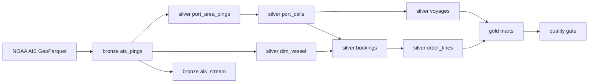

# ais-supply-chain-etl-pipeline

aisetl is a big data ETL project for supply chain and logistics. It takes real ship tracking data (AIS) for US waters, turns 21.9 million position pings into port calls and voyages with Spark, and then uses the real port timing to drive a consumer goods order and shipment model. Every table is a Delta Lake table in a bronze, silver and gold layout, and the whole project installs with `pip`, with no Maven jars to download.

I built it to get good at big data pipelining, and to understand how ocean freight timing reaches an OTIF number at a distribution center.

## Pipeline



## Data

| Source | What it is |
|---|---|
| AIS pings | NOAA Office for Coastal Management daily GeoParquet files for 2024, from the US Coast Guard Nationwide AIS. One file per day, positions stored as WKB points, timestamps rounded to the minute |
| Ports | `reference/ports.csv`, 46 US ports with coordinates, 13 of them marked as container gateways |
| Vessel types and nav status | `reference/vessel_types.csv` and `reference/nav_status.csv`, the standard AIS code tables |
| Orders and shipments | Generated. No company publishes its order lines, so aisetl generates a consumer goods network with 12 plants, 20 DCs, 240 customers, 500 SKUs and 120,000 orders a day |

The run in this README covers January 1 to 3, 2024. That is three files, 683 MB of Parquet and 21,873,664 pings from 18,342 vessels.

The generated side is tied to the real side on purpose. Import containers are booked onto the cargo ships that actually called at a gateway port, and a container is only usable after its ship berthed, unloaded and the truck reached the DC. So when a real ship waited at anchor, every order behind its containers waited too.

## Layers

| Layer | Table | What it holds |
|---|---|---|
| bronze | `ais_pings` | typed pings, deduplicated on mmsi and timestamp, partitioned by file day |
| bronze | `ais_quarantine` | rows that failed a hard rule, with the reason and the raw values |
| bronze | `load_audit` | rows read, kept, quarantined and dropped as duplicates per day |
| bronze | `ais_stream` | the same pings landed again through Structured Streaming |
| silver | `port_area_pings` | pings within 14 km of a port, matched to the nearest one |
| silver | `vessel_days` | pings, distance and speed per vessel per day |
| silver | `port_calls` | one row per call with arrival, berth start and end, departure and anchor wait |
| silver | `voyages` | consecutive calls by the same vessel, port to port |
| silver | `dim_vessel` | SCD2 vessel dimension, a new version whenever name, IMO, call sign, type or size changes |
| silver | `bookings` | containers on real cargo calls at gateway ports |
| silver | `orders`, `order_lines`, `shipment_events`, `inventory_position` | the generated consumer goods side |
| gold | `otif_daily`, `customer_service`, `import_impact` | OTIF, on time, in full and case fill rates |
| gold | `port_performance`, `port_congestion_daily` | dwell, berth time and anchor wait per port |
| gold | `lane_reliability` | transit time spread per lane |
| gold | `inventory_health` | days of supply and stockouts per DC and category |

## How a port call is found

1. Each ping goes to a 0.25 degree grid cell and is joined to a small broadcast table of port cells, then kept if it is within 14 km of a port. Los Angeles and Long Beach are 5 km apart, so a ping keeps only its nearest port.
2. Pings are grouped per vessel in time order. A new call starts after a gap of more than 4 hours, or when the vessel shows up at a port more than 28 km from the last one.
3. A ping counts as berthed when the vessel is under 0.7 knots and its AIS status is moored. When the status is missing, being within 3.5 km of the port point counts instead. Big port complexes like New York and Houston have terminals far from one center point, so the status matters a lot on real data.
4. Anchor wait is the time from the first ping in the port area to the first berthed ping. A call needs at least 45 minutes at berth.

All of these thresholds live in `config.toml`.

## Delta without Maven

The Delta Spark connector comes from Maven, and I wanted the project to install with `pip` only. So Spark writes the Parquet files, and delta-rs commits them into the Delta log as add actions. Reads go the other way, delta-rs lists the active files and Spark reads exactly those. Rerunning a day is one atomic commit that removes that day's files and adds the new ones. Tables still support time travel, history, compaction and vacuum, and the CI job below reads them with the official Delta Spark connector to prove they are normal Delta tables.

## Running it

Needs Python 3.11 or newer and Java 17 or 21. On Windows, Spark also needs `winutils.exe` and `hadoop.dll` in `%HADOOP_HOME%\bin`.

```
python -m venv .venv
.venv\Scripts\activate
pip install -r requirements.txt
python -m aisetl.cli pipeline
python -m aisetl.cli stream
python -m aisetl.cli tuning
python -m aisetl.cli maintenance
```

`pipeline` downloads each day from NOAA, lands it in bronze and deletes the raw file unless it is one of the first `keep_raw_days` days, which the streaming replay needs. Then it builds silver, gold and runs the quality gate. Each stage can also run alone, for example `python -m aisetl.cli port_calls`.

To run without downloading anything, set `source = "generated"` in `config.toml` and run `python -m aisetl.cli generate` first. That writes a full scale replica of the AIS feed with the same columns, including duplicates, corrupt rows, transmission gaps and late files.

`dags/aisetl_dag.py` runs the same stages as an Airflow DAG.

## Tests

84 tests with pytest. They cover config validation, the Delta write, replace and orphan cleanup logic, WKB decoding and the GeoParquet ingest, quarantine and dedupe, port call detection on hand built tracks, voyages and the laden flag, SCD2 versioning, FIFO container allocation, the gold marts, the quality gate, the streaming replay against batch, and the DAG wiring. The end to end tests run the whole pipeline on a small generated replica, so the suite needs no network.

GitHub Actions runs three jobs:

- tests on Python 3.11, 3.12 and 3.13, plus `ruff`
- airflow, which checks the DAG and runs it end to end with `airflow dags test`
- delta-interop, which builds a small lake and reads it back with the Delta Spark connector, checking that row counts match the delta-rs log

## What the data shows

Most port traffic is not freight. Of the 4,184 port calls, 909 were pleasure craft, 659 tugs and 517 towing vessels. Cargo ships made 483 calls and tankers 211.

Cargo ships usually berth fast. Their anchor wait averaged 2.0 hours with a median of 0.92 hours, and they stayed at berth 33.78 hours on average. Only 15 of the 483 cargo calls waited 12 hours or more.

The long waits were on the West Coast. At Oakland, 14 cargo calls averaged 8.35 hours at anchor and one ship waited 70.5 hours. Seattle had 9 cargo calls averaging 7.81 hours, with a longest wait of 67.92 hours. New York and New Jersey had the most cargo calls, 33, with an average wait of 1.5 hours.

Late containers sink OTIF, and on time containers do not. Overall OTIF was 85.94 percent on 900,854 order lines. Here is how the import lines split by when their container became usable compared to the date the order had to ship.

| Import line bucket | Lines | OTIF |
|---|---|---|
| container usable 48 hours or more before the ship date | 54,429 | 94.97% |
| container usable 0 to 48 hours before | 126,791 | 94.96% |
| container usable 0 to 24 hours late | 15,002 | 47.63% |
| container usable more than 24 hours late | 3,977 | 5.20% |
| no container left for that SKU at that DC | 74,229 | 0.00% |
| domestic lines, for comparison | 626,426 | 94.95% |

When the container is in time, an import line does as well as a domestic one. Port waiting shows up directly. Served import lines whose ship waited under 1 hour at anchor hit 93.78 percent OTIF, and lines whose ship waited 24 hours or more hit 66.96 percent.

Supply depends on which ports got ships. The no container lines are not spread evenly. DCs fed through Los Angeles were short on 47.81 percent of their import lines, Seattle on 47.38 percent and Oakland on 46.24 percent, while Norfolk, which had 28 cargo calls in the window, was short on 0.64 percent.

Three days is short for voyages. Only 70 port to port voyages finished inside the window, mostly harbor craft moving between nearby ports like Galveston and Houston or Tacoma and Seattle, and 7 lanes had three or more trips. Import ships mostly arrive from foreign ports, which is why containers are booked from port calls and not from voyages.

The feed is clean. NOAA already removed bad rows from these files, so nothing was quarantined and only 679 exact duplicate pings were dropped. 7 of the 18,342 vessels changed a static attribute within the three days and got a second version in `dim_vessel`.

## Numbers

One clean run over the three days on a small Linux machine with 2 cores and 7 GB of RAM.

| Stage | Output | Seconds |
|---|---|---|
| land | 21,873,664 pings read, 21,872,985 kept | 175.72 |
| silver_pings | 7,629,479 port area pings, 45,016 vessel days | 30.72 |
| port_calls | 4,184 calls | 13.46 |
| voyages | 70 voyages | 0.75 |
| vessel_dim | 18,349 rows | 9.49 |
| cpg | 14,987 containers, 360,000 orders, 900,854 lines, 2,160,000 events | 31.62 |
| gold | 7 marts | 15.69 |
| quality | 32 checks, 0 failed | 22.23 |
| stream | 7,293,408 rows in, 7,293,150 written | 48.32 |
| tuning | 3 join strategies | 20.75 |
| maintenance | 6 tables compacted and vacuumed | 11.25 |

The streaming replay of January 1 wrote 7,293,150 rows, exactly the batch bronze count for that day.

The tuning lab runs the port matching join three ways on one day of pings and reads shuffle metrics from the Spark REST API.

| Strategy | Seconds | Shuffle read | Tasks |
|---|---|---|---|
| shuffle join, 200 partitions, no AQE | 9.46 | 143.25 MB | 605 |
| salted shuffle join, AQE on | 7.51 | 187.18 MB | 11 |
| broadcast join | 2.06 | 21.83 MB | 8 |

Broadcasting the small port table was 4.59 times faster than the plain shuffle join and moved about 15 percent of the data.

Every number above was also recomputed outside Spark in DuckDB, straight from the Parquet files the Delta log points at. The port calls were rebuilt with the same rules in plain SQL and came out at 4,184 with the same average anchor wait of 1.932 hours.
